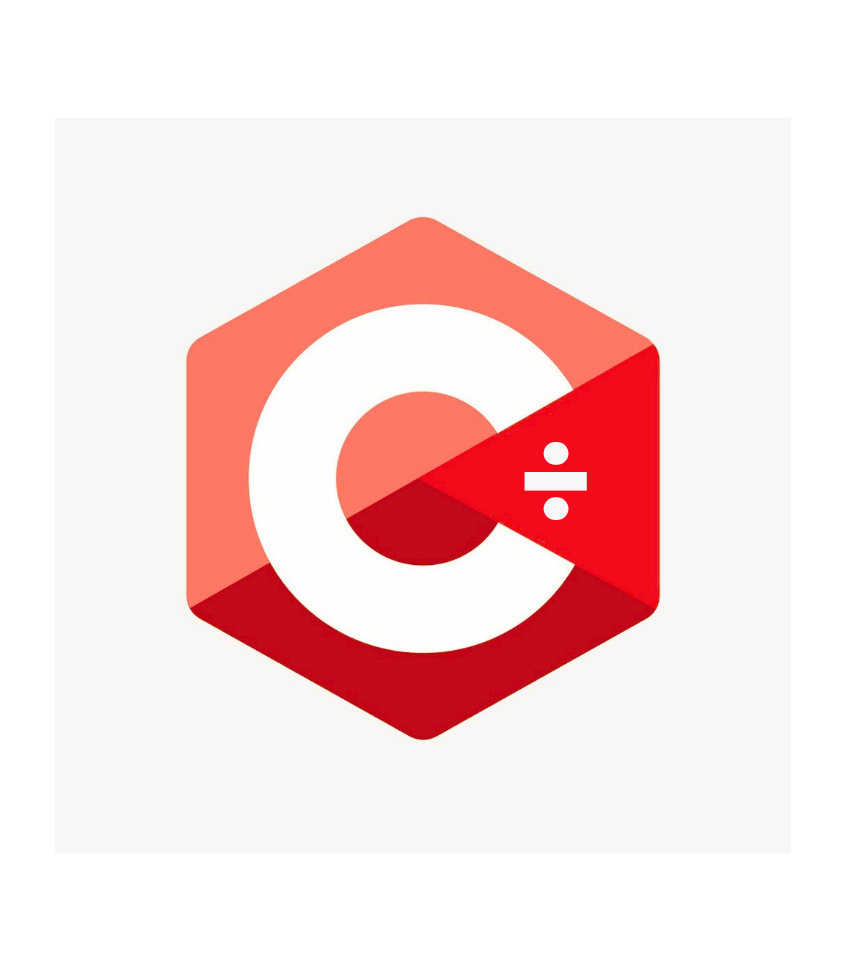

  
  <h1>C÷ · C-Divide</h1>
  
<strong>Downloads:</strong> <a href="https://github.com/floppylib/C-Divide/archive/refs/heads/main.zip">Quellcode als ZIP</a> · <a href="https://cmake.org/download/">CMake 3.20+</a> · <a href="https://visualstudio.microsoft.com/visual-cpp-build-tools/">C++-Buildtools für Windows</a> · <a href="https://www.msys2.org/">MSYS2 / GCC</a> · <a href="https://releases.llvm.org/">LLVM / Clang</a>

  
<em>Zum Bauen benötigen Sie CMake 3.20+ und einen C++20-Compiler. Vorgefertigte C÷-Binärdateien sind noch nicht verfügbar.</em>

  
<strong>Einfach zu lernen. Leistungsfähig beim Entwickeln.</strong>

  
Eine gut lesbare Programmiersprache mit dem Ziel nativer Kompilierung.

<a href="README.md">English</a> · <a href="README.fa.md">فارسی</a> · <a href="README.ar.md">العربية</a> · <a href="README.de.md">Deutsch</a> · <a href="README.es.md">Español</a> · <a href="README.fr.md">Français</a> · <a href="README.hi.md">हिन्दी</a> · <a href="README.ja.md">日本語</a> · <a href="README.pt-BR.md">Português (Brasil)</a> · <a href="README.ru.md">Русский</a> · <a href="README.zh-CN.md">简体中文</a>

---

## Was ist C÷?

C÷ (ausgesprochen **C-Divide**) ist ein Open-Source-Projekt für eine Programmiersprache. Die Sprache soll für Einsteiger leicht zugänglich sein und zugleich die Struktur bieten, die für anspruchsvolle Software nötig ist.

Langfristig soll C÷ eine **nativ kompilierte Sprache** mit automatischer und expliziter Speicherverwaltung, einer Standardbibliothek und eigenen Entwicklerwerkzeugen werden.

> **Aktueller Stand:** Dieses Repository enthält derzeit eine erste Grundlage aus Lexer, Parser und Syntaxprüfung. C÷-Programme werden noch nicht ausgeführt und es werden noch keine nativen ausführbaren Dateien erzeugt. Das Projekt wird auf eine vollständige Version 1.0 hin entwickelt.

## Ein Blick auf die Syntax

~~~cdiv
name = "Hello, C÷!";
print(name);

age = 20;
if age >= 18 {
    print("Welcome!");
} else {
    print("Keep learning!");
}

fn add(a: int, b: int) -> int {
    return a + b;
}
~~~

Das Beispiel zeigt den geplanten Sprachstil. Das aktuelle Frontend kann unterstützte Konstrukte tokenisieren und syntaktisch prüfen. Programmausführung, semantische Analyse und Typprüfung befinden sich noch in Entwicklung. **Die Schlüsselwörter der Sprache C÷ sind derzeit Englisch**; übersetzte README-Dateien bedeuten nicht, dass lokalisierte Schlüsselwörter bereits unterstützt werden.

## Schnellstart

Zum Herunterladen des Quellcodes sind weder ein GitHub-Konto noch Git erforderlich.

**[Quellcode als ZIP herunterladen](https://github.com/floppylib/C-Divide/archive/refs/heads/main.zip)**

Zum Bauen werden ein C++20-Compiler und CMake 3.20 oder neuer benötigt.

**Linux**

~~~sh
cmake -S . -B build -DCMAKE_BUILD_TYPE=Release
cmake --build build --parallel
ctest --test-dir build --output-on-failure
~~~

**Windows — PowerShell**

~~~powershell
cmake -S . -B build
cmake --build build --config Release
ctest --test-dir build -C Release --output-on-failure
~~~

Aktuelle Entwicklungswerkzeuge ausprobieren:

~~~sh
cdiv help
cdiv version
cdiv lex examples/hello.cdiv
cdiv check examples/hello.cdiv
~~~

<code>lex</code> zeigt Tokens und ihre Positionen an. <code>check</code> prüft die lexikalische und grammatikalische Struktur. Diese Befehle führen keine Programme aus und erzeugen noch keine nativen Binärdateien.

## Entwicklungsstand

| Komponente | Status |
| --- | --- |
| C++20- / CMake-Projekt | ✅ |
| Lexer und Positionsdiagnosen | ✅ Erste Version |
| Parser und Syntaxprüfung | ✅ Erste Version |
| Grammatik für Variablen, Funktionen, Bedingungen und Schleifen | ✅ Erkannt, nicht ausgeführt |
| Native Codegenerierung | 🛠 Geplant |
| Laufzeitumgebung und Programmausführung | 🛠 Geplant |
| Semantische Analyse und Typprüfung | 🛠 Geplant |
| Standardbibliothek, Module und Paketmanager | 🛠 Geplant |
| Formatter und Debugger | 🛠 Geplant |

Weitere Informationen stehen in der [Roadmap](docs/roadmap.md) und den [technischen Dokumenten](docs/getting-started.md).

## Downloads und Community

- **Quellcode:** [ZIP-Archiv](https://github.com/floppylib/C-Divide/archive/refs/heads/main.zip), ohne Konto.
- **Veröffentlichungen:** Vorgefertigte Pakete erscheinen auf der Seite [Releases](https://github.com/floppylib/C-Divide/releases), sobald ein Versions-Tag erstellt und der Release-Build erfolgreich abgeschlossen wurde. Derzeit gibt es noch keine vorgefertigten Pakete.
- **Mitwirken:** Bitte [CONTRIBUTING.md](CONTRIBUTING.md) und die [Sicherheitsrichtlinie](SECURITY.md) lesen.

## Dokumentation und Lizenz

Die technischen Leitfäden sind derzeit überwiegend auf Englisch. Übersetzungsbeiträge sind willkommen. Der Quellcode steht unter der [MIT-Lizenz](LICENSE), die Dokumentation unter [CC BY 4.0](LICENSE-DOCS).

---

Offen entwickelt. Zum Lernen entworfen. Auf Wachstum ausgelegt.

