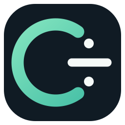

  
  <h1>C÷ — سی‌دایواید</h1>
  
<strong>یادگیری ساده؛ قدرت برای ساختن پروژه‌های بزرگ.</strong>

  
یک زبان برنامه‌نویسی خوانا با هدف کامپایل مستقیم به فایل اجرایی بومی.

  

    
    
    
  

  
<a href="README.md">English</a> · <a href="docs/roadmap.md">نقشه راه</a>

---

## C÷ چیه؟

C÷ یا C-Divide یک پروژه‌ی متن‌باز برای ساخت زبان برنامه‌نویسی‌ای است که یادگیری‌اش راحت باشد، اما در آینده برای پروژه‌های حرفه‌ای هم ابزار کافی داشته باشد.

هدف نهایی، یک زبان کامپایل‌شونده‌ی بومی با مدیریت حافظه‌ی خودکار و دستی، کتابخانه‌ی استاندارد و ابزارهای توسعه‌ی مناسب است.

> <strong>وضعیت واقعی پروژه:</strong> در حال حاضر Lexer و Parser اولیه ساخته شده‌اند. یعنی می‌توانیم توکن‌ها و ساختار دستورات را بررسی کنیم؛ اما هنوز اجرای برنامه و تولید فایل اجرایی بومی پیاده‌سازی نشده است.

## یک نمونه از ظاهر زبان

<pre><code class="language-cdiv">name = "Hello, C÷!";
print(name);

age = 20;
if age &gt;= 18 {
    print("Welcome!");
} else {
    print("Keep learning!");
}

fn add(a: int, b: int) -&gt; int {
    return a + b;
}</code></pre>

## شروع سریع

### ۱. دریافت پروژه، بدون Git

برای دانلود سورس نیازی به حساب GitHub یا نصب Git نیست:

<strong><a href="https://github.com/floppylib/C-Divide/archive/refs/heads/main.zip">⬇ دانلود مستقیم سورس به‌صورت ZIP</a></strong>

فایل را از حالت فشرده خارج کن و پوشه را باز کن.

### ۲. ساخت کامپایلر

پیش‌نیازها: کامپایلر C++20 و نسخه‌ی CMake 3.20 یا جدیدتر.

<strong>لینوکس:</strong>

<pre><code>cmake -S . -B build -DCMAKE_BUILD_TYPE=Release
cmake --build build --parallel
ctest --test-dir build --output-on-failure</code></pre>

<strong>ویندوز PowerShell:</strong>

<pre><code>cmake -S . -B build
cmake --build build --config Release
ctest --test-dir build -C Release --output-on-failure</code></pre>

### ۳. امتحان ابزارها

<pre><code>cdiv help
cdiv version
cdiv lex examples/hello.cdiv
cdiv check examples/hello.cdiv</code></pre>

- دستور <code>lex</code> توکن‌های کد را نمایش می‌دهد.
- دستور <code>check</code> ساختار دستوری و واژگانی کد را بررسی می‌کند.

فعلاً برنامه‌های C÷ اجرا یا به فایل اجرایی مستقل تبدیل نمی‌شوند.

## بخش‌های پروژه

- <code>src/</code> کد کامپایلر
- <code>examples/</code> نمونه‌برنامه‌ها
- <code>tests/</code> تست‌ها
- <code>docs/</code> مستندات
- <code>scripts/</code> ابزارهای نصب
- <code>.github/workflows/</code> ساخت و تست خودکار

## مجوزها

- سورس‌کد: MIT
- مستندات: Creative Commons Attribution 4.0

راهنماهای کامل‌تر در <a href="docs/getting-started.md">مستندات</a> قرار دارند.
