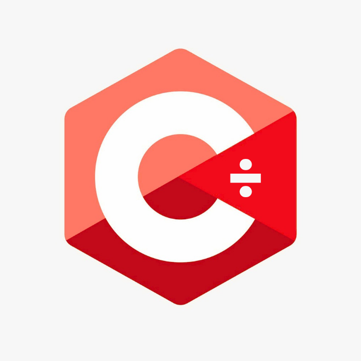

  
  <h1>C÷ · C-Divide</h1>
  
<strong>सीखना आसान। निर्माण के लिए शक्तिशाली।</strong>

  
एक सरल और पठनीय प्रोग्रामिंग भाषा, जिसका लक्ष्य नेटिव कंपाइलेशन है।

<a href="README.md">English</a> · <a href="README.fa.md">فارسی</a> · <a href="README.ar.md">العربية</a> · <a href="README.de.md">Deutsch</a> · <a href="README.es.md">Español</a> · <a href="README.fr.md">Français</a> · <a href="README.hi.md">हिन्दी</a> · <a href="README.ja.md">日本語</a> · <a href="README.pt-BR.md">Português (Brasil)</a> · <a href="README.ru.md">Русский</a> · <a href="README.zh-CN.md">简体中文</a>

---

## C÷ क्या है?

C÷ (उच्चारण **C-Divide**) एक ओपन-सोर्स प्रोग्रामिंग भाषा परियोजना है। इसका उद्देश्य शुरुआती लोगों के लिए कोडिंग को आसान बनाना है, साथ ही गंभीर सॉफ़्टवेयर बनाने के लिए ज़रूरी संरचना भी उपलब्ध कराना है।

दीर्घकालिक लक्ष्य एक ऐसी **भाषा बनाना है जो नेटिव एक्ज़ीक्यूटेबल कोड में कंपाइल हो सके**, जिसमें मेमोरी का ऑटोमैटिक और स्पष्ट नियंत्रण, एक स्टैंडर्ड लाइब्रेरी और डेवलपर टूल शामिल हों।

> **वर्तमान स्थिति:** इस रिपॉज़िटरी में lexer, parser और syntax checker का शुरुआती आधार मौजूद है। यह अभी C÷ प्रोग्राम चलाता नहीं है और नेटिव executable फ़ाइलें भी नहीं बनाता। परियोजना को पूर्ण 1.0 रिलीज़ तक विकसित किया जा रहा है।

## सिंटैक्स का एक उदाहरण

~~~cdiv
name = "Hello, C÷!";
print(name);

age = 20;
if age >= 18 {
    print("Welcome!");
} else {
    print("Keep learning!");
}

fn add(a: int, b: int) -> int {
    return a + b;
}
~~~

यह उदाहरण भाषा की नियोजित शैली दिखाता है। मौजूदा फ्रंट-एंड समर्थित संरचनाओं को tokens में बदल सकता है और उनका syntax जाँच सकता है। प्रोग्राम चलाना, semantic analysis और type checking अभी विकास में हैं। **C÷ भाषा के keywords फिलहाल अंग्रेज़ी में हैं**; README का अनुवाद होने का अर्थ यह नहीं कि स्थानीय भाषा के keywords समर्थित हैं।

## जल्दी शुरू करें

सोर्स कोड डाउनलोड करने के लिए GitHub अकाउंट या Git इंस्टॉल करना ज़रूरी नहीं है।

**[ZIP में सोर्स कोड डाउनलोड करें](https://github.com/floppylib/C-Divide/archive/refs/heads/main.zip)**

बिल्ड करने के लिए C++20 compiler और CMake 3.20 या नया संस्करण चाहिए।

**Linux**

~~~sh
cmake -S . -B build -DCMAKE_BUILD_TYPE=Release
cmake --build build --parallel
ctest --test-dir build --output-on-failure
~~~

**Windows — PowerShell**

~~~powershell
cmake -S . -B build
cmake --build build --config Release
ctest --test-dir build -C Release --output-on-failure
~~~

मौजूदा डेवलपमेंट टूल आज़माएँ:

~~~sh
cdiv help
cdiv version
cdiv lex examples/hello.cdiv
cdiv check examples/hello.cdiv
~~~

<code>lex</code> tokens और उनके source positions दिखाता है। <code>check</code> lexical और grammatical structure की जाँच करता है। ये कमांड अभी प्रोग्राम नहीं चलाते और न ही native executable बनाते हैं।

## विकास की स्थिति

| भाग | स्थिति |
| --- | --- |
| C++20 / CMake प्रोजेक्ट | ✅ |
| Lexer और source-position diagnostics | ✅ शुरुआती संस्करण |
| Parser और syntax checker | ✅ शुरुआती संस्करण |
| Variables, functions, conditions और loops का grammar | ✅ पहचाना जाता है, चलता नहीं |
| Native code generation | 🛠 योजनाबद्ध |
| Runtime और program execution | 🛠 योजनाबद्ध |
| Semantic और type analysis | 🛠 योजनाबद्ध |
| Standard library, modules और package manager | 🛠 योजनाबद्ध |
| Formatter और debugger | 🛠 योजनाबद्ध |

अधिक जानकारी के लिए [roadmap](docs/roadmap.md) और [तकनीकी गाइड](docs/getting-started.md) देखें।

## डाउनलोड और समुदाय

- **सोर्स कोड:** [ZIP archive](https://github.com/floppylib/C-Divide/archive/refs/heads/main.zip), अकाउंट की ज़रूरत नहीं।
- **रिलीज़:** version tag बनने और release build सफल होने के बाद prebuilt packages [Releases पेज](https://github.com/floppylib/C-Divide/releases) पर आएँगे। अभी कोई prebuilt package प्रकाशित नहीं है।
- **योगदान:** [CONTRIBUTING.md](CONTRIBUTING.md) और [Security Policy](SECURITY.md) पढ़ें।

## दस्तावेज़ और लाइसेंस

तकनीकी गाइड अभी मुख्य रूप से अंग्रेज़ी में हैं। उनके अनुवाद में योगदान का स्वागत है। सोर्स कोड [MIT License](LICENSE) और दस्तावेज़ [CC BY 4.0](LICENSE-DOCS) के अंतर्गत हैं।

---

खुले तौर पर विकसित। सीखने के लिए डिज़ाइन किया गया। आगे बढ़ने के लिए तैयार।

