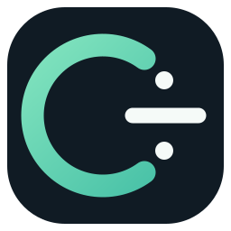

  
  <h1>C÷ · C-Divide</h1>
  
<strong>Simple to learn. Powerful to build.</strong>

  
A readable programming language with a native-compilation goal.

  

    
    
    
    
    
  

  

    <a href="README.fa.md">فارسی</a> ·
    <a href="#quick-start">Quick start</a> ·
    <a href="docs/getting-started.md">Getting started</a> ·
    <a href="docs/language.md">Language guide</a> ·
    <a href="docs/roadmap.md">Roadmap</a>
  

---

## ✨ What is C÷?

C÷ (pronounced <strong>C-Divide</strong>) is an open programming-language project. Its goal is to make code approachable for new programmers without giving up the structure needed for serious software.

The long-term direction is a <strong>native compiled language</strong> with automatic and manual memory-management options, a useful standard library, and friendly developer tools.

> <strong>Honest status:</strong> this repository currently contains an early lexer and syntax checker. It does not execute C÷ programs or generate native executables yet. The project is being built toward a complete 1.0 release.

## 🚀 A taste of the syntax

<pre><code class="language-cdiv">name = "Hello, C÷!";
print(name);

age = 20;
if age >= 18 {
    print("Welcome!");
} else {
    print("Keep learning!");
}

fn add(a: int, b: int) -&gt; int {
    return a + b;
}</code></pre>

This is the intended language style. The current front end can tokenize and syntax-check examples like this; runtime behavior and type checking are still under development.

## 🧭 Project principles

| Principle | Direction |
| --- | --- |
| Readability | Familiar words, clean blocks, predictable syntax |
| Performance | Native executable output is the goal |
| Memory | Automatic and explicit control, with safety rules to be specified |
| Portability | Windows and Linux first; other platforms can follow |
| Tooling | One clear CLI, good diagnostics, formatter and package tools |
| Accessibility | Downloadable archives and simple installers; no Git knowledge required |

## ⚡ Quick start

### 1. Get the source — no Git required

You do <strong>not</strong> need a GitHub account, Git, or a terminal to download the project source.

<strong><a href="https://github.com/floppylib/C-Divide/archive/refs/heads/main.zip">⬇ Download the source as a ZIP</a></strong>

Unzip it, then open the extracted folder in a terminal. If you prefer Git, the usual clone command is:

<pre><code>git clone https://github.com/floppylib/C-Divide.git
cd C-Divide</code></pre>

### 2. Build it

Requirements: a C++20 compiler and CMake 3.20 or newer.

<strong>Linux</strong>

<pre><code>cmake -S . -B build -DCMAKE_BUILD_TYPE=Release
cmake --build build --parallel
ctest --test-dir build --output-on-failure</code></pre>

<strong>Windows — PowerShell</strong>

<pre><code>cmake -S . -B build
cmake --build build --config Release
ctest --test-dir build -C Release --output-on-failure</code></pre>

### 3. Try the tools

The executable is named <code>cdiv</code> (or <code>cdiv.exe</code> on Windows).

<pre><code>cdiv help
cdiv version
cdiv lex examples/hello.cdiv
cdiv check examples/hello.cdiv</code></pre>

- <code>lex</code> displays tokens and their source positions.
- <code>check</code> checks lexical and grammatical structure.

These are compiler-development commands. They do not run the program or produce a native executable yet.

## 📦 Downloads without GitHub know-how

C÷ is designed so people can use it without learning Git or creating an account.

- <strong>Source code:</strong> use the ZIP link above. It is a direct archive download.
- <strong>Ready-to-run compiler tools:</strong> once the first tagged release is published, Windows and Linux packages will appear on the <a href="https://github.com/floppylib/C-Divide/releases">Releases page</a>. No account is needed to download public release files.
- <strong>Install scripts:</strong> <code>scripts/install.sh</code> and <code>scripts/install.ps1</code> install a locally built or downloaded <code>cdiv</code> executable into your user account by default.

Prebuilt packages are not published yet. The release workflow is prepared, but a package will only be available after a version tag is created and the release build succeeds.

## 🧩 What's implemented?

| Component | Status |
| --- | --- |
| C++20 / CMake project | ✅ |
| Lexer and source-position diagnostics | ✅ Initial version |
| Parser and syntax checker | ✅ Initial version |
| Variables, calls, functions, conditions and loops in grammar | ✅ Parsed, not executed |
| Automated build and test workflow | ✅ |
| Native code generation | 🛠 Planned |
| Runtime and program execution | 🛠 Planned |
| Semantic and type analysis | 🛠 Planned |
| Standard library and module system | 🛠 Planned |
| Memory-management model | 🧭 Design work |
| Package manager, formatter and debugger | 🛠 Planned |

See the <a href="docs/roadmap.md">roadmap</a> for the bigger picture.

## 📚 Documentation

| Guide | What you'll find |
| --- | --- |
| <a href="docs/getting-started.md">Getting started</a> | Build C÷ on Windows or Linux |
| <a href="docs/language.md">Language guide</a> | Syntax currently recognized by the front end |
| <a href="docs/architecture.md">Architecture</a> | How the compiler is structured |
| <a href="docs/roadmap.md">Roadmap</a> | Planned milestones |
| <a href="docs/faq.md">FAQ</a> | Common questions |
| <a href="docs/downloads.md">Downloads</a> | Source archives and release packages |

Persian readers: start with the <a href="README.fa.md">راهنمای فارسی</a>.

## 🤝 Community

C÷ is open to suggestions, bug reports, documentation improvements, and code contributions.

- Read <a href="CONTRIBUTING.md">CONTRIBUTING.md</a> before opening a pull request.
- Use the issue templates for bug reports and feature ideas.
- Read the <a href="CODE_OF_CONDUCT.md">Code of Conduct</a> and <a href="SECURITY.md">Security Policy</a>.

No contribution is too small: a clear bug report or a better example is useful.

## 📜 Licensing

- <strong>Source code:</strong> <a href="LICENSE">MIT License</a>.
- <strong>Documentation:</strong> <a href="LICENSE-DOCS">Creative Commons Attribution 4.0 (CC BY 4.0)</a>.

Third-party components, if introduced later, will be listed separately in <a href="THIRD_PARTY_NOTICES.md">THIRD_PARTY_NOTICES.md</a>.

---

  Built in the open. Designed to be learned. Made to grow.

