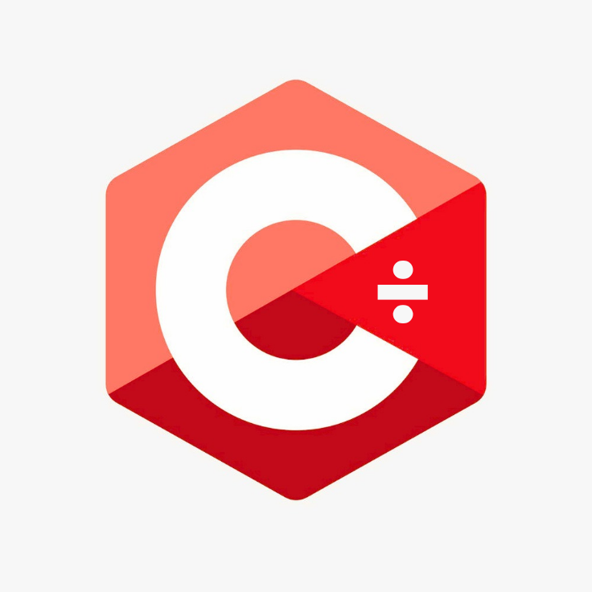

  
  <h1>C÷ · C-Divide</h1>
  
<strong>Легко изучать. Мощно создавать.</strong>

  
Понятный язык программирования, нацеленный на нативную компиляцию.

<a href="README.md">English</a> · <a href="README.fa.md">فارسی</a> · <a href="README.ar.md">العربية</a> · <a href="README.de.md">Deutsch</a> · <a href="README.es.md">Español</a> · <a href="README.fr.md">Français</a> · <a href="README.hi.md">हिन्दी</a> · <a href="README.ja.md">日本語</a> · <a href="README.pt-BR.md">Português (Brasil)</a> · <a href="README.ru.md">Русский</a> · <a href="README.zh-CN.md">简体中文</a>

---

## Что такое C÷?

C÷ (произносится **C-Divide**) — открытый проект языка программирования. Его цель — сделать программирование доступным для начинающих, не отказываясь от структуры, необходимой для серьёзного программного обеспечения.

В перспективе C÷ должен стать **языком с компиляцией в нативный код**, вариантами автоматического и явного управления памятью, стандартной библиотекой и собственными инструментами разработчика.

> **Текущее состояние:** в репозитории есть начальная основа лексера, парсера и проверки синтаксиса. Программы C÷ пока не выполняются, а нативные исполняемые файлы не создаются. Разработка ведётся в направлении полноценного выпуска 1.0.

## Пример синтаксиса

~~~cdiv
name = "Hello, C÷!";
print(name);

age = 20;
if age >= 18 {
    print("Welcome!");
} else {
    print("Keep learning!");
}

fn add(a: int, b: int) -> int {
    return a + b;
}
~~~

Это пример предполагаемого стиля языка. Текущая фронтенд-часть умеет разбивать поддерживаемые конструкции на токены и проверять их синтаксис. Выполнение программ, семантический анализ и проверка типов ещё разрабатываются. **Ключевые слова самого языка C÷ пока английские**; перевод README не означает поддержку локализованных ключевых слов.

## Быстрый старт

Для загрузки исходного кода не нужны ни аккаунт GitHub, ни установленный Git.

**[Скачать исходный код в ZIP](https://github.com/floppylib/C-Divide/archive/refs/heads/main.zip)**

Для сборки нужны компилятор C++20 и CMake версии 3.20 или новее.

**Linux**

~~~sh
cmake -S . -B build -DCMAKE_BUILD_TYPE=Release
cmake --build build --parallel
ctest --test-dir build --output-on-failure
~~~

**Windows — PowerShell**

~~~powershell
cmake -S . -B build
cmake --build build --config Release
ctest --test-dir build -C Release --output-on-failure
~~~

Попробуйте текущие инструменты разработки:

~~~sh
cdiv help
cdiv version
cdiv lex examples/hello.cdiv
cdiv check examples/hello.cdiv
~~~

Команда <code>lex</code> показывает токены и их позиции в исходном файле. <code>check</code> проверяет лексическую и грамматическую структуру. Эти команды пока не запускают программы и не создают нативные исполняемые файлы.

## Состояние разработки

| Компонент | Статус |
| --- | --- |
| Проект C++20 / CMake | ✅ |
| Лексер и диагностика позиций | ✅ Начальная версия |
| Парсер и проверка синтаксиса | ✅ Начальная версия |
| Грамматика переменных, функций, условий и циклов | ✅ Разбирается, но не исполняется |
| Генерация нативного кода | 🛠 В планах |
| Среда выполнения и запуск программ | 🛠 В планах |
| Семантический анализ и проверка типов | 🛠 В планах |
| Стандартная библиотека, модули и менеджер пакетов | 🛠 В планах |
| Форматтер и отладчик | 🛠 В планах |

Подробности — в [дорожной карте](docs/roadmap.md) и [технической документации](docs/getting-started.md).

## Загрузки и сообщество

- **Исходный код:** [ZIP-архив](https://github.com/floppylib/C-Divide/archive/refs/heads/main.zip), аккаунт не требуется.
- **Релизы:** готовые пакеты появятся на странице [Releases](https://github.com/floppylib/C-Divide/releases), когда будет создан тег версии и сборка релиза завершится успешно. Сейчас готовых пакетов ещё нет.
- **Участие в проекте:** прочитайте [CONTRIBUTING.md](CONTRIBUTING.md) и [политику безопасности](SECURITY.md).

## Документация и лицензия

Технические руководства пока в основном написаны на английском. Помощь с переводом приветствуется. Исходный код распространяется по лицензии [MIT](LICENSE), документация — по [CC BY 4.0](LICENSE-DOCS).

---

Открытая разработка. Создан для обучения. Готов расти.

